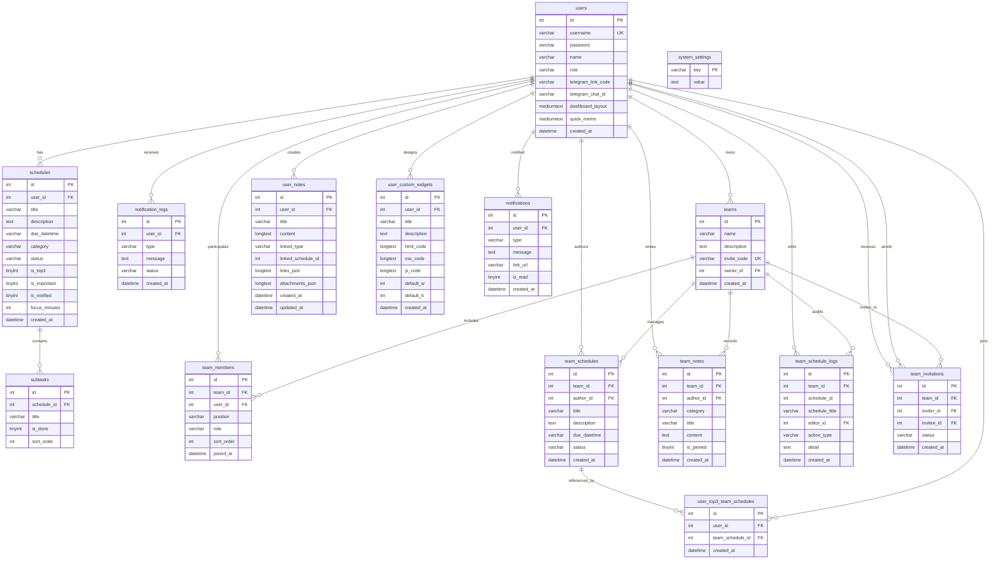

# WorkSmarter (워크스마트)

> **스마트 일정 및 모듈형 워크스페이스 관리 웹 애플리케이션**

WorkSmarter는 개인의 일상 업무와 생산성 관리부터 팀 단위의 협업까지 유기적으로 연결하는 올인원 워크스페이스 솔루션입니다. 사용자는 드래그 앤 드롭 기반의 자유로운 모듈형 대시보드와 독립 플로팅(PIP) 팝업 창을 통해 나만의 최적화된 업무 환경을 구축할 수 있으며, 칸반 보드·월간 캘린더·문서함(노트)·팀 협업 공간·실시간 알림함·게스트 모드 등 체계적인 생산성 도구를 완벽하게 활용할 수 있습니다.

---

## 1. 프로젝트 소개 및 핵심 기능 요약

### 1) 개인 워크스페이스 (Personal Workspace)
* **모듈형 GridStack 대시보드 & 레이아웃 커스텀**: 12열 반응형 그리드 시스템을 기반으로 Top 3, 생산성 통계 차트, 일정 워크스페이스, 빠른 일정 등록, 실시간 시계, 메모장 등 각 위젯의 위치와 크기를 자유롭게 재배치할 수 있으며, 0px 경계선 밀착 모드 및 기본 프리셋 초기화 기능을 지원합니다.
* **독립 플로팅 PIP(Picture-in-Picture) 모드**: 각 대시보드 위젯을 브라우저 뷰포트 내 독립적인 플로팅 윈도우로 분리하여 최소화·복원 및 화면 내 자유로운 이동이 가능합니다.
* **오늘의 핵심 목표 Top 3 (MIT)**: 가장 중요한 3가지 핵심 목표를 상단에 고정하고 드래그 앤 드롭으로 우선순위를 즉시 변경할 수 있습니다.
* **칸반 보드 (Kanban Board)**: 상태별(`TODO`, `IN_PROGRESS`, `DONE`, `EXPIRED`) 컬럼 간 양방향 드래그 앤 드롭을 통한 직관적인 진행 상태 변경 및 다중 선택 일괄 변경/삭제를 지원합니다.
* **월간 인터랙티브 캘린더 (Calendar)**: 기한이 지정된 일정과 기한 미지정(상시) 일정 간의 상호 드래그 앤 드롭 날짜 이동, 마감일 자동 분류 및 복구, 한국/미국/일본 등 국가별 공휴일 동적 표시를 제공합니다.
* **일정 상세보기 플로팅 팝오버 & 우클릭 메뉴**: 일정 카드를 우클릭하여 노션 스타일 컨텍스트 메뉴를 호출하고, 가벼운 플로팅 팝오버를 통해 일정의 진행률, 서브태스크, 연결 문서를 즉시 확인할 수 있습니다.

### 2) 세부사항 및 문서함 (Notes & Documentation)
* **일정-문서 양방향 연결 태그**: 개인 일정 및 팀 일정과 노트를 상호 연결하여 일정 상세 팝오버 및 문서함에서 관련 컨텍스트를 원클릭으로 탐색할 수 있습니다.
* **리치 문서 작성 및 자동 저장**: 마크다운 서식 지원, 외부 웹 링크 추가, 파일 첨부(PDF, 문서 등) 업로드 및 다운로드를 안전하게 처리합니다.

### 3) 팀 협업 공간 (Team Workspace)
* **팀 전용 캘린더 & 칸반 뷰**: 소속 팀원들이 공유하는 전용 월간 캘린더 및 칸반 뷰를 제공하여 팀 프로젝트 일정을 한눈에 파악합니다.
* **`@아이디` 기반 팀원 초대**: 복잡한 절차 없이 `@아이디` 입력만으로 팀원을 즉시 초대할 수 있습니다.
* **공통 상단 헤더 알림함**: 읽지 않은 알림과 대기 중인 팀 참여 요청 건수를 실시간 뱃지로 안내하며, 초대 수락/거절 및 알림 일괄 읽음 처리를 지원합니다.
* **역할 기반 권한 관리 및 팀 나가기**: 팀장(LEADER), 관리자(MANAGER), 팀원(MEMBER) 권한 분리 및 팀장 탈퇴 시 최초 가입자 자동 위임 시스템을 갖추고 있습니다.

### 4) 브라우저 캐시 기반 게스트 모드 (Guest Mode)
* **무계정 즉시 체험**: 별도의 DB 회원가입이나 로그인 절차 없이 로그인 화면의 `[게스트로 시작하기]` 버튼을 통해 대시보드를 즉각 체험할 수 있습니다.
* **`localStorage` 자동 동기화**: 게스트 상태에서 생성하거나 수정한 일정, 서브태스크, 메모, 위젯 배치는 사용자의 브라우저 로컬 저장소에 자동으로 영구 보관 및 복원됩니다.
* **상단 게스트 안내 배지**: 현재 게스트 모드임을 명확히 안내하며, 원클릭으로 정식 로그인 및 회원가입 화면으로 전환할 수 있습니다.

---

## 2. 핵심 기술 스택 및 아키텍처 역할 상세 설명

| 기술 (Technology) | 구분 | 아키텍처 역할 및 주요 구현 포인트 |
| :--- | :--- | :--- |
| **Node.js** | Backend Runtime | 비동기 이벤트 루프 기반 서버 구동, `fs`/`path` 모듈을 통한 업로드 파일 및 정적 자산 관리, `dns`/`https` 모듈을 활용한 외부 알림 API 비동기 통신 처리 |
| **Express** | Web Framework | RESTful 라우팅 및 비동기 JSON API(`/api/*`) 설계, `express-session` 기반 사용자 인증 및 권한 검증 미들웨어(팀 멤버십·IDOR 방어), `multer` 기반 문서 파일 업로드 처리 |
| **EJS** | View Template Engine | SSR(Server-Side Rendering) 기반 동적 화면 렌더링, 공통 레이아웃 모듈화(고정 사이드바, 상단 실시간 24시간 시계 및 알림함 헤더), `<%= %>` 자동 HTML 이스케이프 처리를 통한 XSS 방어 |
| **MySQL (`mysql2/promise`)** | Database Engine | InnoDB 스토리지 엔진 및 커넥션 풀(Connection Pool) 기반 관계형 데이터 모델링, 외래키(`FOREIGN KEY ... ON DELETE CASCADE`) 참조 무결성 및 트랜잭션 제어, Prepared Statement(`?` 바인딩)를 통한 SQL 인젝션 차단 |
| **GridStack & Chart.js** | Frontend Libraries | 양방향 드래그 앤 드롭 모듈형 대시보드 그리드 제어(GridStack v10), 카테고리별 업무/개인 생산성 달성 현황 도넛 차트 시각화(Chart.js v4) |

---

## 3. 데이터베이스 ERD (Entity-Relationship Diagram)



### 핵심 테이블 역할 및 관계 설명

| 테이블명 | 주요 역할 및 참조 무결성(Cascade) 제약 |
| :--- | :--- |
| `users` | 기본 계정 정보, 사용자 권한(`USER`/`ADMIN`), 대시보드 위젯 배치 설정(`dashboard_layout`), 빠른 메모(`quick_memo`) 보관 |
| `schedules` | 개인 일정 데이터. `user_id`를 외래키로 참조하며 계정 삭제 시 연계 삭제(`ON DELETE CASCADE`) |
| `subtasks` | 각 일정 하위의 체크리스트 실행 단계. `schedule_id`를 외래키로 참조하여 상위 일정 삭제 시 자동 정리 |
| `system_settings` | 텔레그램 봇 토큰 및 Gemini API 키 등 동적 시스템 환경설정 키-값(`key`, `value`) 저장소 |
| `notification_logs` | 텔레그램 발송 이력 및 전송 성공/실패 여부 로깅 |
| `teams` | 협업 그룹 기본 정보 및 초대 코드(`invite_code`). 팀 소유자(`owner_id`)가 삭제되면 해당 팀 데이터 자동 정리 |
| `team_members` | 팀 소속 멤버십 및 역할(`LEADER`, `MANAGER`, `MEMBER`). `(team_id, user_id)` 복합 유니크 제약 적용 |
| `team_schedules` | 팀 공유 일정 정보. 소속 팀(`team_id`) 및 작성자(`author_id`)를 각각 외래키로 참조 |
| `team_notes` | 팀 공유 문서 및 회의록. 중요도에 따른 상단 고정(`is_pinned`) 지원 |
| `team_schedule_logs` | 팀 일정의 생성, 상태 변경, 수정 이력을 추적하는 감사 로그(Audit Log) |
| `user_top3_team_schedules`| 팀 일정을 개인 대시보드의 Top 3 목표로 가져와 핀 고정하는 매핑 테이블 |
| `user_notes` | 개인 문서함 데이터. 개인/팀 일정과의 상호 연결(`linked_schedule_id`) 및 파일 첨부 메타데이터 보관 |
| `user_custom_widgets` | 사용자가 직접 제작하거나 공유 코드로 설치한 커스텀 위젯 소스코드 보관 |
| `team_invitations` | `@아이디` 기반의 팀 참여 초대 상태(`PENDING`, `ACCEPTED`, `DECLINED`) 추적 |
| `notifications` | 공통 상단 헤더 알림함에 전달되는 시스템 및 초대 알림 데이터 |

---

## 4. 디렉토리 구조 및 실행 가이드

### 디렉토리 구조
```text
webplanner/
├── app.js                          # Express 메인 애플리케이션 (MySQL 비동기 풀 연동)
├── package.json                    # 프로젝트 의존성 및 메타데이터 정의
├── package-lock.json               # NPM 패키지 락 파일
├── .env                            # 환경변수 설정 파일 (PORT, DB 접속 정보 등)
├── .env.example                    # 환경변수 템플릿 예시
├── public/                         # 정적 자산 디렉토리
│   ├── style.css                   # Notion 스타일 전역 CSS 디자인 시스템
│   └── uploads/                    # 사용자 문서 첨부파일 저장소
└── views/                          # EJS 뷰 템플릿 디렉토리
    ├── admin.ejs                   # 관리자 통합 관제 콘솔
    ├── index.ejs                   # 메인 대시보드 화면 (개인 워크스페이스 & 게스트 모드)
    ├── login.ejs                   # 로그인 화면 (게스트 모드 진입 포함)
    ├── mypage.ejs                  # 마이페이지 및 알림 연동 관리
    ├── notes.ejs                   # 세부사항 및 문서함 화면
    ├── register.ejs                # 신규 회원가입 화면
    ├── teams.ejs                   # 팀 워크스페이스 및 전용 캘린더 화면
    └── partials/                   # 공통 컴포넌트 모듈
        ├── header-clock.ejs        # 상단 실시간 24시간 슬림 시계
        ├── mini-timer.ejs          # 플로팅 미니 포모도로 타이머
        └── notification-dropdown.ejs # 상단 헤더 알림 & 팀 초대 드롭다운
```

### 사전 요구사항
* **Node.js**: v18.0.0 이상 권장
* **MySQL**: v8.0 이상 (InnoDB 스토리지 엔진 지원)
* **NPM**: v9.0.0 이상

### 설치 및 실행 순서

1. **저장소 클론 및 패키지 설치**
   ```bash
   npm install
   ```

2. **MySQL 데이터베이스 생성**
   MySQL 서버에 접속한 후, utf8mb4 문자셋으로 데이터베이스를 생성합니다:
   ```sql
   CREATE DATABASE worksmarter CHARACTER SET utf8mb4 COLLATE utf8mb4_unicode_ci;
   ```

3. **환경변수 설정**
   `.env.example` 파일을 복사하여 `.env` 파일을 생성하고 MySQL 접속 정보를 설정합니다:
   ```bash
   cp .env.example .env
   ```
   ```env
   # Server Configuration
   PORT=3000
   SESSION_SECRET=worksmarter_secret_key

   # Database Configuration (MySQL)
   DB_HOST=127.0.0.1
   DB_PORT=3306
   DB_USER=root
   DB_PASSWORD=your_password
   DB_NAME=worksmarter

   # Telegram Bot API (Optional)
   TELEGRAM_BOT_TOKEN=

   # Google Gemini API Key (Optional)
   GEMINI_API_KEY=
   ```

4. **서버 실행**
   ```bash
   node app.js
   ```
   서버 시작 시 MySQL 연결 상태를 확인하고, 필요한 모든 InnoDB 테이블이 자동으로 생성됩니다.
   실행 후 브라우저에서 `http://localhost:3000`으로 접속하여 서비스를 이용하실 수 있습니다.
